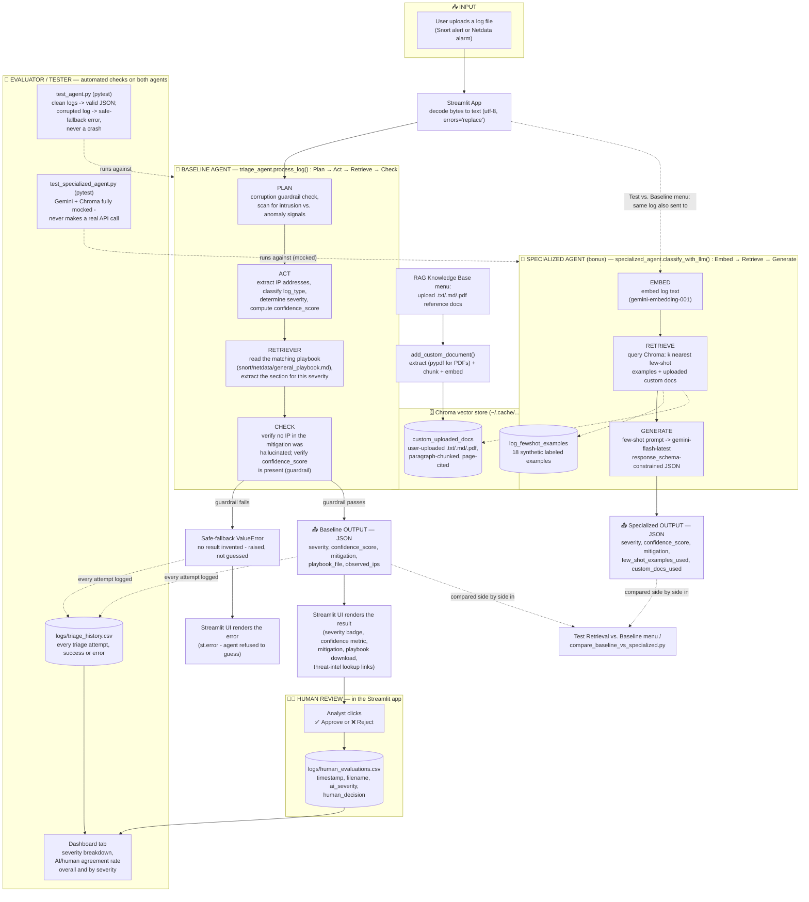

# System Architecture Diagram

This document contains the visual Mermaid architecture diagram for the Log Triage Agent, illustrating data flow from ingestion through the baseline agent, specialized LLM agent, Chroma vector retrieval, and human-in-the-loop evaluation.

